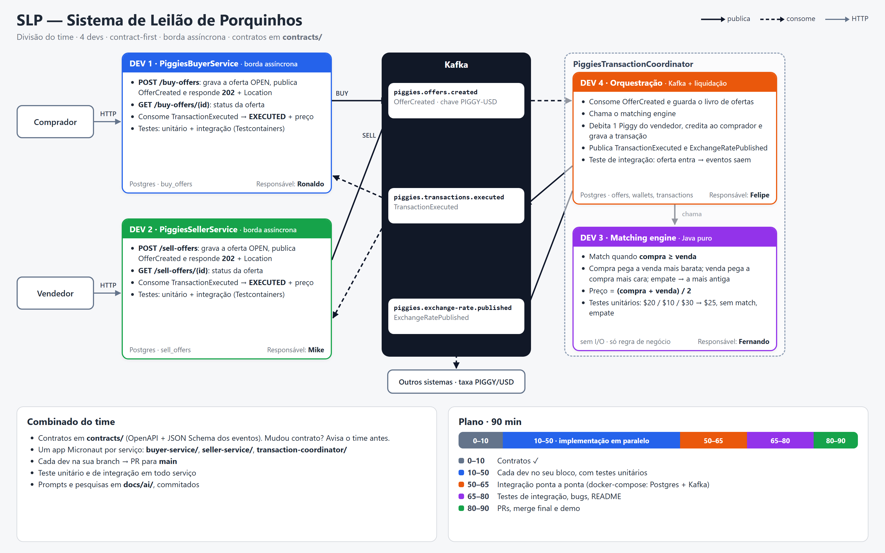

# Desafio DTI Inter — SLP (Sistema de Leilão de Porquinhos)

Live code do Inter: três microsserviços Micronaut que fazem o leilão de Piggies. Enunciado em [INSTRUCOES.md](INSTRUCOES.md).



| Pasta | Serviço | Porta |
|---|---|---|
| `buyer-service/` | PiggiesBuyerService | 8090 |
| `seller-service/` | PiggiesSellerService | 8091 |
| `transaction-coordinator/` | PiggiesTransactionCoordinator | 8092 |

- Contratos (OpenAPI e JSON Schema dos eventos): [contracts/](contracts/)
- Passo a passo por dev: [docs/passo-a-passo/](docs/passo-a-passo/)
- Uso de IA (prompts e decisões): [docs/ai/](docs/ai/)
- Infra local (Postgres e Kafka): `docker compose up -d` e depois `./infra/create-kafka-topics.sh`
- A raiz tem o app base do time, com os smoke tests de infraestrutura e a classe `IntegrationTest` que os serviços reaproveitam.

## Stack

- Java 25
- Micronaut 5.1 (Netty, YAML, validação, Problem JSON, Management)
- Maven 3.9
- Micronaut Data JPA (Hibernate) e Jakarta Data, com PostgreSQL 16
- Kafka
- Testes com JUnit 5, AssertJ, Awaitility e Testcontainers
- Lombok

## Pré-requisitos

- Conta no GitHub
- [mise](https://mise.jdx.dev/installing-mise.html)
- [Docker](https://docs.docker.com/engine/install), com o engine rodando (os testes sobem containers)
- Java, Maven e Micronaut CLI, instalados pelo mise:

```bash
mise use java@25
mise use maven@3.9
mise use micronaut@5.1
```

- Imagens usadas pelos Testcontainers:

```bash
docker pull postgres:16-alpine
docker pull apache/kafka-native:4.3.1
```

## Geração dos serviços

Os três apps já estão gerados. Para referência, o comando usado (na pasta vazia de cada serviço):

```bash
mn create-app --inplace --build=maven --jdk=25 --lang=java --test=junit \
  --features=yaml,data-jpa,hibernate-jpa,hibernate-jpamodelgen,jakarta-data,postgres,testcontainers,assertj,awaitility,junit-params,lombok,logback,management,kafka,netty-server,jspecify,micronaut-http-validation,problem-json,validation \
  co.inter.piggies.buyer.buyer-service
```

Os outros: `co.inter.piggies.seller.seller-service` e `co.inter.piggies.coordinator.transaction-coordinator`.

## Testes

Em cada pasta de serviço:

```bash
mvn test
```

PostgreSQL e Kafka sobem em containers pelo Testcontainers, então o Docker precisa estar no ar.
