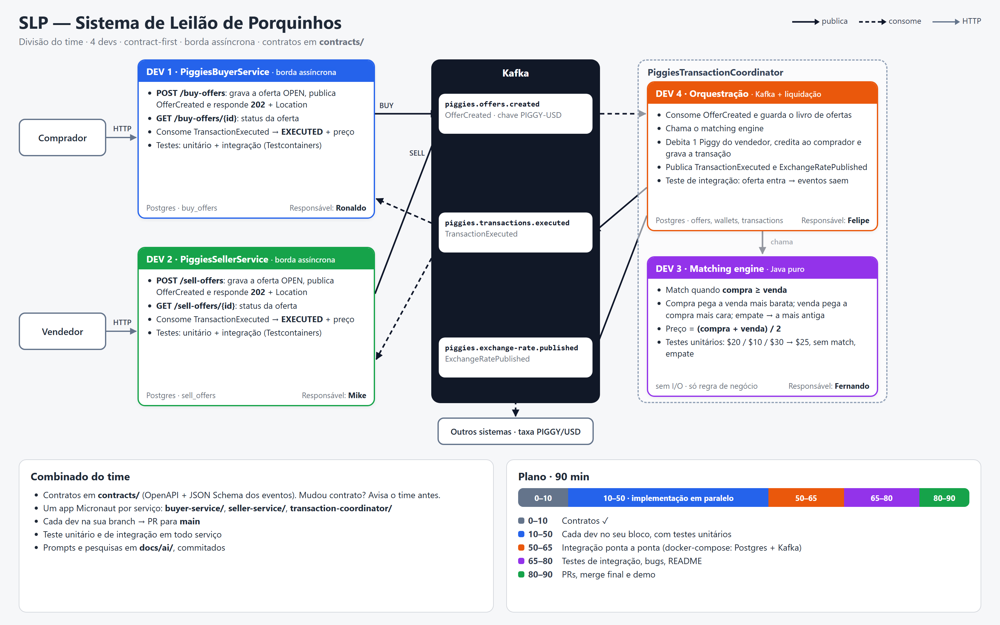

# Passo a passo por dev



| Dev | Quem | Guia | Pasta | Porta | Branch |
|---|---|---|---|---|---|
| 1 | Ronaldo | [Buyer](dev-1-buyer.md) | `buyer-service/` | 8090 | `dev1-buyer` |
| 2 | Mike | [Seller](dev-2-seller.md) | `seller-service/` | 8091 | `dev2-seller` |
| 3 | Fernando | [Matching engine](dev-3-matching-engine.md) | `transaction-coordinator/` (pacote `matching`) | — | `dev3-matching` |
| 4 | Felipe | [Orquestração](dev-4-orquestracao.md) | `transaction-coordinator/` | 8092 | `dev4-coordinator` |

Portas 8080 (app da raiz) e 8081 (Kafka UI do docker-compose) ficam livres.

## Todos, antes de começar (5 min)

1. Crie a sua branch a partir da `main`:

   ```bash
   git fetch origin
   git switch -c dev1-buyer origin/main
   ```

2. Leia `contracts/README.md` e o contrato do seu serviço. Mudança de contrato só depois de combinar com o time.
3. Confira o Docker: `docker info`. Os testes de integração sobem Postgres e Kafka com Testcontainers.
4. **Os três apps já estão gerados na `main`**: `buyer-service/`, `seller-service/` e `transaction-coordinator/`. Não gere de novo. Cada um já tem:
   - `application.yml` com a porta do serviço e o Postgres e o Kafka do `docker-compose.yml`;
   - a base `IntegrationTest` (a mesma da raiz), que sobe Postgres e Kafka com Testcontainers;
   - o teste gerado pelo Micronaut já estendendo essa base.

   Todo teste de integração fica assim:

   ```java
   @MicronautTest
   class BuyOfferFlowTest extends IntegrationTest { ... }
   ```

   O `InfraSmokeTest`, o `PingProducer` e o `PingListener` da raiz mostram como publicar e consumir no Kafka dentro de um teste.

5. O `mvn test` de um app recém-gerado falha com "Entities not found for JPA configuration" até existir a primeira `@Entity`. É esperado: comece pela entidade.
6. IntelliJ: abra a raiz do repositório e adicione o `pom.xml` do seu serviço no painel Maven (botão `+`).
7. Registre prompts e pesquisas em `docs/ai/dev-N.md`, um arquivo por dev para não dar conflito.
8. A cada pedaço que funciona: `mvn test` verde, commit, push e PR para `main`.

## Integração ponta a ponta (50–65 min)

1. Na raiz: `docker compose up -d` e depois `./infra/create-kafka-topics.sh` (cria os 3 tópicos do contrato)
2. Em cada pasta de serviço: `mvn mn:run`
3. Rode o exemplo do enunciado (no PowerShell use `curl.exe`, não `curl`):

   ```bash
   curl.exe -i -X POST localhost:8091/sell-offers -H "Content-Type: application/json" -d "{\"sellerId\":\"A\",\"price\":20}"
   curl.exe -i -X POST localhost:8090/buy-offers  -H "Content-Type: application/json" -d "{\"buyerId\":\"B\",\"price\":10}"
   curl.exe -i -X POST localhost:8090/buy-offers  -H "Content-Type: application/json" -d "{\"buyerId\":\"C\",\"price\":30}"
   ```

4. Esperado: as três respostas são `202`. Em seguida, `GET` na oferta de C (URL do `Location`) e na de A devolvem `EXECUTED` com `executedPrice` 25; a oferta de B continua `OPEN`.
5. Para ver as mensagens: `docker compose --profile ui up -d` e abra http://localhost:8081.
